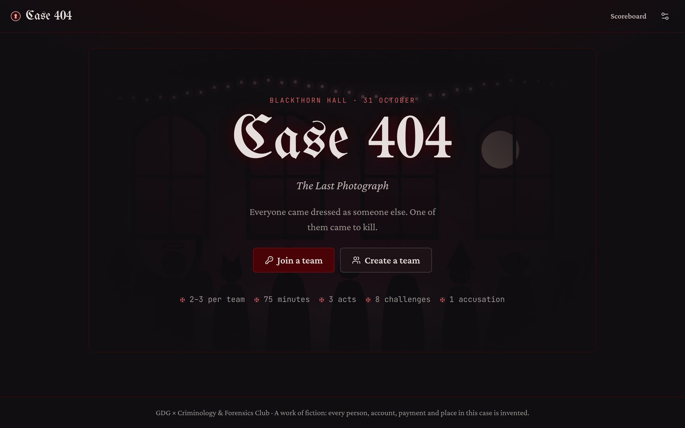
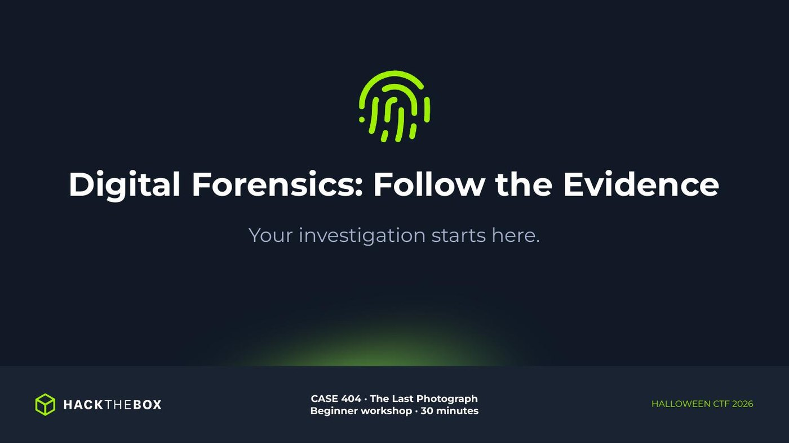
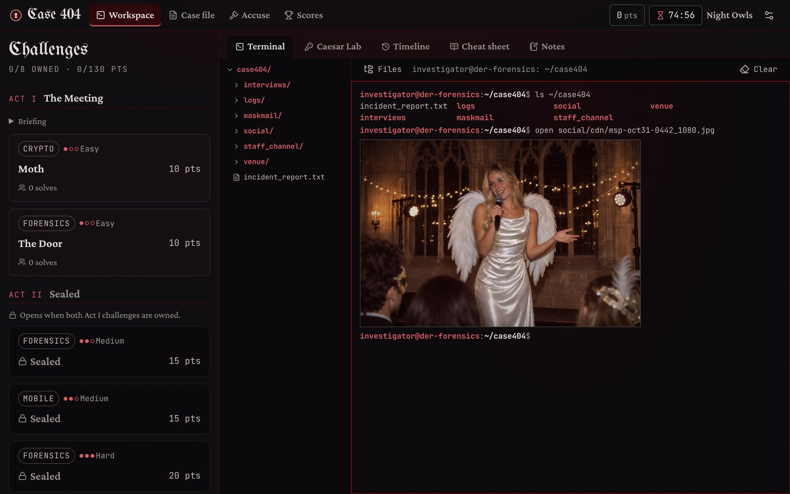
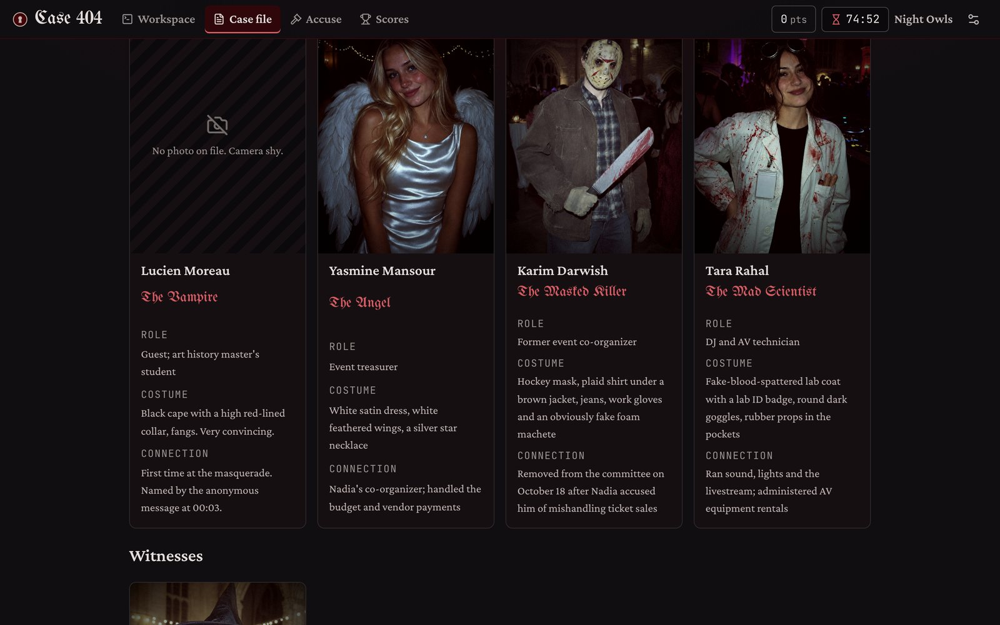
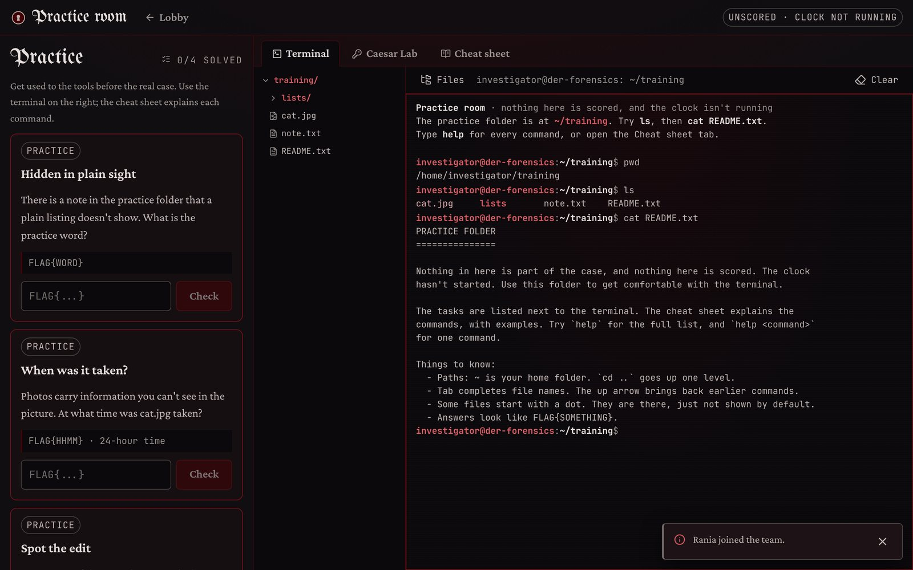

# CASE 404 — The Last Photograph

**A beginner-friendly digital forensics (DFIR) murder-mystery CTF, played in the browser.**



Blackthorn Hall, 31 October. The charity masquerade was at its loudest when the livestream went dark. At 00:06 the student organizer was found dead upstairs, and an anonymous message had already named a killer. Teams of 2–3 get 75 minutes, a Linux-style terminal over the evidence, and three acts of challenges to find out what really happened, then one accusation to name the killer, the motive and anyone who helped.

Designed, built and presented by **Lea El Mawla** ([@lumawla](https://github.com/lumawla)).

> **Spoiler policy.** This README is spoiler-free. The culprit, flags and full solution live in [`private/organizer/`](private/organizer/), which the server reads but never serves to players. If you plan to play, don't open that folder. If you want to run CASE 404 for your own event, host it from a private copy of this repository, because the answer key is public here.

## The event

I presented CASE 404 live at a GDG × Criminology & Forensics Club (American University of Beirut) Halloween event, in two parts:

1. **A short beginner lecture on DFIR, in collaboration with Hack The Box.** A 30-minute, hands-on introduction for people who had never used a terminal: what digital forensics is, reading the terminal, `grep`, hidden files, photo metadata, SHA-256 hashing, `diff`, the Caesar cipher, file formats and pipes, ending with the investigation method (question, locate, inspect, compare, record, submit). Every example uses fictional practice files, so nothing in the talk spoils the case.
2. **The CTF itself.** Teams warmed up in the unscored practice room, then pressed Begin and worked the case against the clock.

The slides I presented, with full speaker notes:
[PowerPoint](docs/workshop/CASE404_Beginner_Forensics_Workshop.pptx) · [PDF](docs/workshop/CASE404_Beginner_Forensics_Workshop.pdf)

[](docs/workshop/CASE404_Beginner_Forensics_Workshop.pdf)

## Skills demonstrated

**Digital forensics and incident response**
- Evidence integrity: a read-only evidence tree, intake manifests that seal items by SHA-256, and checking copies against recorded hashes.
- Metadata and media forensics: EXIF timestamps (capture, modification and upload are different events) and what metadata can and can't prove.
- Log analysis and timeline reconstruction: access-control, device and network logs, mail records and CCTV stills from many sources, correlated into one timeline.
- Mobile and application artifacts: SQLite databases, JSON message exports, screenshots, and data an app no longer shows.
- Document and financial records: text extraction from PDFs and comparing different versions of the same record.
- Basic cryptanalysis: Caesar-shifted messages.

**CTF and scenario design**
- A three-act story where each act's evidence only mounts once enough of the previous act is solved, with a difficulty curve from easy (10 points) to hard (25 points).
- Red herrings and evidence that isn't what it seems, so teams have to verify instead of guess, and a final accusation that needs a motive and supporting evidence, not just a name.
- A beginner on-ramp: practice room, cheat sheet, in-terminal `help <command>`, and the workshop above.

**Software and security engineering**
- Full-stack TypeScript: a Fastify API on `node:sqlite`, a React + Vite client and shared packages in an npm workspace.
- An in-browser shell with about 50 commands (pipes, globs, redirection, Tab completion and history) running over the real evidence bytes: `grep`, `find`, `jq`, `sqlite3`, `exiftool`, `strings`, `xxd`, `sha256sum`, `diff`, `pdftotext` and more.
- Anti-cheat and spoiler separation: flags and the accusation rule are checked only on the server, sealed acts answer as if they don't exist, submissions are rate-limited, and a build step fails if the client bundle ever contains a flag, the solution or evidence content.
- Reproducible content: the evidence, the photo evidence (AI-generated pictures of fictional people, graded to one look), the EXIF metadata and the hash manifests are all generated by scripts.

**Testing and operations**
- Unit and API integration tests (Vitest) and end-to-end playthroughs on desktop and phone (Playwright).
- An organizer dashboard (pause and resume, open acts, extend time, announcements, audit log), a Docker image, a Render blueprint and a one-command free public link (`npm run host`) for event day.

**Teaching and communication**
- Wrote and delivered the beginner lecture, the speaker notes, the practice tasks and the in-game cheat sheet for people with no command-line experience.

## Tech stack

| Layer | Tools |
|---|---|
| Front end | React 19, TypeScript, Vite 8, plain CSS with a custom design system (blackletter titles, terminal UI) |
| Back end | Node.js 22, Fastify 5, SQLite via the built-in `node:sqlite`, server-side flag checking and rate limiting |
| In-browser terminal | A TypeScript shell over a virtual file system: parser, pipes, globs, redirection and about 50 commands |
| Evidence pipeline | Node scripts for the seeded evidence and hash manifests, Python (Pillow, numpy) for photo grading, Chromium for image, PDF and EXIF generation |
| Testing | Vitest (unit and API integration), Playwright (end-to-end on desktop and phone) |
| Deployment | Docker, Render blueprint, Cloudflare quick tunnel (`npm run host`) |

## A look inside

| Investigation workspace | Case file |
|---|---|
|  |  |

| Practice room | |
|---|---|
|  | Teams work a challenge board grouped by act next to the **Terminal**, **Caesar Lab**, **Timeline**, **Cheat sheet** and shared **Notes**. Players can also `download` any file and use their own tools. Every person, account, payment and place in the case is fictional. |

## Run it yourself

Requirements: Node.js **22.13+** (it uses the built-in `node:sqlite`).

```bash
npm install
npm run dev            # API on :8787 + web on http://localhost:5173
```

Sign in at `/admin` with the dev organizer token `dev-admin-token`, then turn on **Teams may press Begin**. Teams need **2 members** to begin by default: open a second browser profile to join, or lower *Min team* to 1 in the dashboard.

### Production

```bash
npm install
npm run build          # web → apps/web/dist, API → apps/api/dist/server.js
NODE_ENV=production ADMIN_TOKEN='long-random' APP_SECRET='long-random' npm start
```

The API serves the built client on the same origin (port 8787 by default). Put it behind an HTTPS reverse proxy (set `TRUST_PROXY=1`) or use the [`Dockerfile`](Dockerfile).

- **Free hosting for the event:** on a laptop with [cloudflared](https://developers.cloudflare.com/cloudflare-one/connections/connect-networks/downloads/) installed, `npm run host` starts the server and prints a public `https://…trycloudflare.com` link and the organizer token.
- **Persistent practice link:** a Render blueprint is included in [`render.yaml`](render.yaml).
- All settings are in [`.env.example`](.env.example). Event-day operations are in [docs/event-runbook.md](docs/event-runbook.md), and verification and rollback in [docs/event-readiness.md](docs/event-readiness.md).

## Commands

| Command | What it does |
|---|---|
| `npm run dev` | API and web dev servers |
| `npm run build` | Production build of web and API, including the spoiler-leak check |
| `npm start` | Run the built server |
| `npm run host` | Production server plus a free public Cloudflare tunnel link |
| `npm test` | Unit and API integration tests (Vitest) |
| `npm run test:e2e` | Playwright playthroughs on desktop and phone (run `npm run build` first) |
| `npm run typecheck` | TypeScript across all packages |
| `npm run check:bundle` | Fails if the built client contains flags, the accusation rule, the solution or evidence content |
| `npm run evidence` | Rebuilds the record evidence (logs, registries, ledgers, the Messages database, the practice lists) from one seeded timeline and re-hashes the intake manifests |
| `npm run photos` | Rebuilds the portraits and photo evidence from the AI-generated pictures in `scripts/art/photos/` (Python 3 with Pillow and numpy); run `npm run assets` after it |
| `npm run assets` | Regenerates the image and PDF evidence with Chromium, writes the story EXIF and re-hashes the intake manifests |

## Repository layout

```text
apps/
  api/              Fastify + node:sqlite server (teams, timer, flags, accusation, notes, admin)
  web/              React + Vite client
    src/terminal/   The in-browser shell: virtual file system, parser, ~50 commands
packages/shared/    Types and pure logic used by both (Caesar, EXIF reader, rules)
content/
  public/           Story for the case file page and the venue plan
  evidence/fs/      The evidence players explore (~/case404), plus meta.json (timestamps, the act each file opens in)
  training/         The practice room's folder (~/training) and its four tasks
  gated/            Challenges, acts, timeline, accusation options (served as each act opens)
private/organizer/  Answer key and facilitator sheet: server-only, never served
scripts/            Evidence, photo and asset generators, hosting helper, test server, spoiler check
tests/              unit/, integration/, e2e/
docs/               Architecture, runbook, QA checklist, decisions, the workshop deck, screenshots
design-system/      Palette, type and interaction rules
```

## Documentation

- [docs/architecture.md](docs/architecture.md): components, data model, security and spoiler separation
- [docs/event-runbook.md](docs/event-runbook.md): before, during and after the event, and emergencies
- [docs/qa-checklist.md](docs/qa-checklist.md): acceptance criteria and how each is verified
- [docs/decisions.md](docs/decisions.md): design choices and what changed along the way
- [design-system/case-404/MASTER.md](design-system/case-404/MASTER.md): visual and interaction rules

All characters, accounts, payments, messages and places are fictional. The people in the photos are AI-generated and don't exist.
